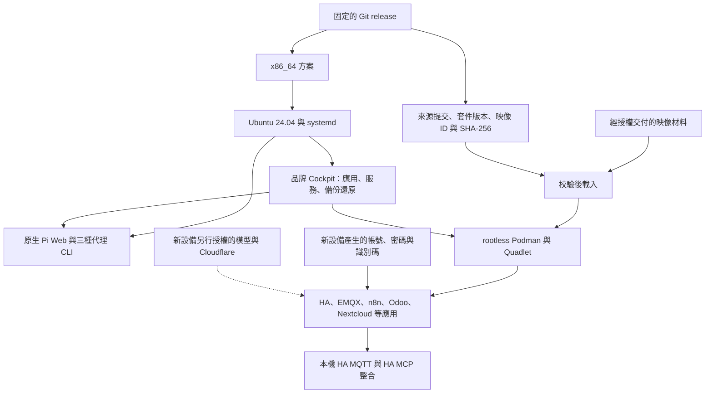

# 版本組合與設備邊界

本方案把參考設備分成三層，讓其他機器能依同一份版本鎖安裝。借鑑 HAOS 的硬體方案與版本清單概念，但不安裝 Supervisor，也不把 Podman 容器描述成 HA add-on。

| 範圍 | 固定內容 | 每台設備不同的內容 |
| --- | --- | --- |
| 底座 | Ubuntu 24.04 系列、Podman／Cockpit 關鍵套件版本 | 主機名稱、IP、SSH host key、machine-id、Linux 帳號 |
| 原生代理 | Pi Web 及 Node／Claude／Codex 等釘選版本 | 模型供應商登入、使用者專案、原生 Omnigent host 身分 |
| 應用 | 37 個映像的內容 ID、47 個正式容器與 Quadlet 設定 | 新資料庫、Podman secrets、初始管理員與應用資料 |
| 管理 | 品牌頁面、HTTP 區網入口、Pi Web 獨立登入、備份引擎 | 應用外部網址、備份緊急金鑰與備份檔 |
| 外部連線 | Cloudflare、Headscale、MCP 管理功能已安裝 | PaaS／Tunnel、VPN 節點、kubeconfig、個別後端授權 |

「同一版本」指上述程式與映像內容可核對一致，不是複製來源設備的使用者資料或登入身分。Ubuntu 核心與其餘 apt 套件另留設備安裝清單；本候選版不是逐位元相同的 OS 映像。

`main` 保留開發進度，交付必須指定 release tag／commit。下一版應新增版本鎖與驗收紀錄，不能把舊版鎖直接改成當日最新版本。私人映像的來源或授權改變時，也須重新審查材料取得方式。

目前只驗收 N100 上的 x86_64 組合。後續 J1900、J6412 或其他 RAM／磁碟容量方案，應以各自的 profile 明列預裝應用與限制，再分別進行新機安裝、資源負載及重開機測試；不能直接沿用本次驗收結論。
