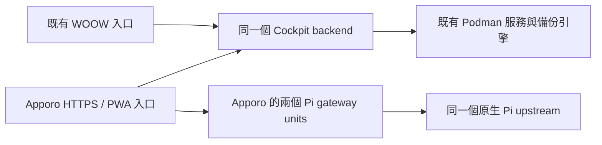

# 同一台設備的 Apporo 並行入口

這是既有主機的可選第二個管理入口。WOOW 與 Apporo 連到**同一份 Cockpit、Podman 應用、備份引擎及原生 Pi**；新增的是入口與品牌呈現。它不建立第二組 47 個應用容器，也不提供租戶隔離。從任一入口執行的服務、備份或 Pi 操作，都作用於同一台設備及相同資料。

Apporo 並行入口已完成下列參考主機實測。[Cockpit PR19](https://github.com/WOOWTECH/Woow_cockpit/pull/19) 在該輪交接時已推送至 `b561633`；後續入口與品牌修正仍由主代理整合，當輪結果及[待完成項目](#驗證範圍與待完成項目)分別記錄。本 distribution 的共同材料仍釘在 `73871247139a054de07c2e4275a6108aa2cd5bb0`，須等最終已合併的 commit／tree 才更新。現有 pin 缺少 `parallel-ingress/manage.py` 時，wrapper 仍會在呼叫 sudo 前拒絕；PR head 不當成正式 source pin。

## 已完成的參考主機驗收

以下為 Cockpit 主代理在 2026-11-17 提供的實機與測試結果；來源與範圍另見 [PR19 說明](https://github.com/WOOWTECH/Woow_cockpit/pull/19)：

| 項目 | 此輪結果 |
| --- | --- |
| Apporo Pi Web | 實際對話、助理回覆與 SSE 串流通過 |
| 品牌主題 | Apporo Pi 主題切換通過 |
| 應用及服務頁 | 讀到 13 張應用卡片、312 項服務及 49 個容器狀態 |
| 備份排程 UI | 實際排程表單操作通過 |
| 來源產物與共同後端 | 當輪快照記錄 93 項 rendered assets、25 項 common backend 檔案 |
| Root config 與入口測試 | root ownership／祖先目錄條件已實作；27 項入口測試通過 |

服務／容器數是該參考主機當次 UI 查詢結果，不改變本 distribution 的 rc1 47-container profile，也不代表新增了 49 個容器。排程表單操作通過不延伸宣稱所有應用都已完成真實備份還原。

## 驗證範圍與待完成項目

上表保留主代理在當時來源與主機狀態下完成的結果。後續 nginx／Quadlet 品牌修正與 favicon／字型變更仍在整合，最終組合須對照實際 commit／tree 重新確認相關驗收；當輪資產數量與測試結果不自動套用到修改後的來源。

Apporo 專用 public origin 目前仍在規劃，**尚未建立 DNS／subscription，相關外部設定仍待核准**。CFGUI 路由維持其原服務用途，不是 Apporo 公開入口。本文與設定範例一律使用 `https://apporo.example.test`，不將已規劃的網址寫成已發布入口；需要正式網址的操作須等該設備的授權、DNS、HTTPS 與路由設定完成。

**外部 Cloudflare OTP／Access 尚未驗收。** public-origin 的本機鏈路測試與實際 UI 操作不代表通過外部 OTP；原 Access policy 仍是獨立授權層，此功能不會移除或繞過它。

最終交接尚須記錄整合後的來源與驗收對應、CI／合併結果、完整 commit／tree／main ancestry，以及 distro 材料 pin。此分工只修改文件與本機程式／測試，不修改現用 nginx、Quadlet、DNS、subscription 或 Cloudflare policy，也不自行推送。

## 選擇正確的流程

| 需求 | 流程 | 影響範圍 |
| --- | --- | --- |
| 全新設備建立整套服務 | `woow-release.py apply --brand apporo` | 新設備的完整應用與全域品牌 |
| 已由 distribution 管理的設備切換全域品牌 | `woow-release.py brand --brand apporo` | 現有主要 Cockpit／PWA／Pi 呈現 |
| 保留 WOOW，另加 Apporo 管理入口 | 本頁的 `parallel-ingress.py` | 個別 instance 的入口；共用原主機後端 |

並行入口不呼叫 `brand`、`cockpit` 或 `apply`。其來源與主要品牌使用同一份已審查材料；全域 `brand.json` receipt 及品牌選擇仍由原安裝流程管理。



## Config 與主機責任

Cockpit root installer 的設定約定為 `/etc/cockpit/parallel-ingress-config/<instance>.json` 下的 root-owned JSON，`schema` 為 1。設定檔必須是一般檔案，檔案及各層祖先目錄均由 root 擁有，不可經過 symlink，也不可讓 group／other 寫入。只把一般帳號家目錄裡的 JSON 改成 root owner，仍不符合祖先目錄條件。root installer 已實作這些檢查，結果列於上方驗收紀錄。

設定不包含密碼、Token、Cookie、Linux 登入或 Podman secrets；既有帳號、服務擁有者及授權繼續使用。以最終固定來源中的 schema／範例及 `plan --config` 驗證設定，wrapper 不複製另一套 config validator。

| 欄位／用途 | 此次介面約定 | 說明 |
| --- | --- | --- |
| `schema` | `1` | 已對照目前 Cockpit renderer；正式使用前仍核對最終固定來源 |
| `instance` | `apporo` | instance 的生命週期識別 |
| `brand` | `apporo` | 此入口的呈現，不改全域品牌 |
| `owner` | `operator` | 佔位名稱；須填該主機原有的 rootless Podman owner |
| `public_origin` | `https://apporo.example.test` | 核准後配置的精確 HTTPS origin；範例本身不建立 DNS 或 public 路由 |
| `listen_port` | `29092` | 此 instance 的主要入口埠；目前 renderer 綁定 `127.0.0.1` |
| `compatibility_port` | `18000`，可省略 | public 相容別名；不是第二份應用，也不應作為 LAN／VPN 的廣泛別名 |
| `pi_public_port` | `19096` | 此 instance 的 public Pi gateway |
| `pi_local_port` | `19097` | 此 instance 的 local Pi gateway |
| `cockpit_port` | `9090` | 已有 Cockpit backend；若設備已移到其他埠，須填實際 backend 埠 |
| `pi_upstream_port` | `30141` | 同一個原生 Pi upstream |
| `node_path` | `/usr/bin/node` | root installer 驗證的 Node 路徑；不使用可由一般帳號修改的執行檔 |
| `image` | 固定 nginx digest | 使用已核對的 immutable image reference；不使用浮動 tag |

上表是介面交接，不是可直接安裝的 JSON。這份 rc1 鎖的 PWA nginx 來源 reference 是 `docker.io/nginxinc/nginx-unprivileged@sha256:5aea7cc516b419e3526f47dd1531be31a56a046cfe44754d94f9383e13e2ee99`；image config ID 是 `sha256:696695300a3c18a324c07ecb41f220e8c470302148b0378770cf5c70e6458ea0`。兩者不同，不能互換。最終入口 config 的映像仍須符合 Cockpit installer 支援的格式與已審查材料，不藉此改寫 rc1 的既有 PWA image alias。

輸入 JSON 放在 `/etc/cockpit/parallel-ingress-config/`；產物由 Cockpit root installer 放在 `/etc/cockpit/parallel-ingress/<instance>/releases/...`。Apporo 使用者 Quadlet 沿用 `apporo-cockpit-pwa` 名稱，以支援既有樣板入口的原地更新；兩個 Pi gateway 是分開的 root systemd units。精確檔案清單、unit 名稱及 transaction journal 以最終來源的 plan／verify 為準。

安裝前，Cockpit installer 嚴格比對主機已安裝的管理 helper／engine bytes 與固定來源；不一致時拒絕部署。不能靠這個 wrapper 順帶升級共享後端，也不能為繞過 parity 檢查而全域切成 Apporo。共享後端同步應另按 Cockpit 的維護流程處理並保留主入口品牌。

Cockpit `Origins` 以新增允許 origin 的方式處理，保留原 WOOW origin；proxy 不偽造 `Origin` 來繞過驗證。現有主機的 Cloudflare／DNS／TLS／Access 設定須維持有效；新增 JSON 不代表外網路由已完成。

## Distribution wrapper

以原部署帳號在受信任的 distribution checkout 操作。wrapper 不接受開發來源或任意 material lock，固定使用兩品牌共同的 production 材料。

```bash
# 只讀取本機已提交材料，不建立 state、不 fetch、不 sudo。
python3 distribution/installer/parallel-ingress.py plan
```

這個 `plan` 僅輸出來源選擇，明確標示 `scope: source-selection`、`instance_validated: false` 及 `runtime_verified: false`。其中 source 的 ready／release_eligible 沿用材料選擇語義，不代表 parallel CLI 存在、instance 設定有效、backend parity 通過或執行計畫的設備已完成驗收。它不解析 Cockpit `plan` 的 JSON，不依賴上游報告欄位。

正式來源與 instance config 就緒後，wrapper 的介面如下；這些是設備操作指令，本次文件與測試工作沒有執行它們：

```bash
python3 distribution/installer/parallel-ingress.py install \
  --config /etc/cockpit/parallel-ingress-config/apporo.json
python3 distribution/installer/parallel-ingress.py verify --instance apporo
python3 distribution/installer/parallel-ingress.py rollback --instance apporo
```

wrapper 透過 `brand_profile.select()` 選擇固定來源，再由 `prepare_source()` 複製、fetch 並驗證。staging 位於 `~/.local/state/woow-release/2026.11.15-rc1/parallel-ingress/branding/production/<commit>/`；不讀寫其上層主要安裝的 `brand.json`，也不建立假的 `device.json`。wrapper 沒有全域品牌切換、應用初始化、帳號 bootstrap 或資料卷操作。

install／verify／rollback 會準備並驗證來源，因此可能建立上述 staging 及讀取上游 Git；wrapper 的 plan 才是完全不建 state 的來源查詢。Cockpit 自己的 `plan --config` 另會驗證 instance 設定與已安裝後端，不等同於 wrapper 的來源 plan。wrapper 不以 root 執行整體流程，只在確認來源後將動作交給固定的 Cockpit CLI。以下 `<pinnedCockpit>` 必須是已通過 provenance 驗證的 staging：

```text
sudo env PYTHONDONTWRITEBYTECODE=1 python3 <pinnedCockpit>/parallel-ingress/manage.py plan --config /etc/cockpit/parallel-ingress-config/apporo.json
sudo env PYTHONDONTWRITEBYTECODE=1 python3 <pinnedCockpit>/parallel-ingress/manage.py install --config /etc/cockpit/parallel-ingress-config/apporo.json
sudo env PYTHONDONTWRITEBYTECODE=1 python3 <pinnedCockpit>/parallel-ingress/manage.py verify --instance apporo
sudo env PYTHONDONTWRITEBYTECODE=1 python3 <pinnedCockpit>/parallel-ingress/manage.py rollback --instance apporo
```

config 以絕對路徑原樣傳遞，root 擁有權、祖先目錄／symlink 檢查、schema、連接埠、後端 parity、交易與錯誤由 Cockpit CLI 負責。其非零退出碼會保留；失敗時不自動切品牌或退回未鎖定來源。rollback 作用於該 instance 的入口交易，不能當成應用資料、備份排程或全域品牌的回退工具；可回復範圍以該交易 journal 為準。

## 最終 pin 與驗證交接

兩品牌繼續共同指向 [2026.11.17-dual-brand.json](../brand-materials/2026.11.17-dual-brand.json)。最終 Cockpit 實作由主代理負責，本分工不猜測 commit／tree。取得已合併來源後，同時核對 repository、完整 commit、tree 及 `main_commit`，再提交材料鎖；未提交或被修改的材料鎖會被現有 `load_lock()` 拒絕。

來源驗證要求 commit 是釘選 main commit 的祖先，且該 main commit 仍位於 fetched `origin/main`。`parallel-ingress/manage.py` 不在既有四項 overlay 允許清單內，不能靠 staging 補一份 installer 或修改其內容來繞過最終 pin。也不修改歷史 `releases/2026.11.15-rc1/lock.json`、`materials.json` 或 `v2026.11.15-rc1` tag。

合併交接應包含：

1. 最終 Cockpit SHA／tree／main ancestry、root config schema、plan／verify／rollback 的實際結果及限制。
2. 將上方已完成的 Apporo UI／Pi／排程驗收與最終來源對照，附上兩品牌回歸及後續驗收結果與範圍。
3. 原 WOOW origin、全域品牌、既有 service owners、應用映像／資料／Secrets、Pi upstream 及原網路設定的保留結果。
4. instance 重跑、失敗恢復與 rollback，以及 public 相容別名和一般 LAN／VPN 路徑的隔離結果。

本 distribution 的本機檢查使用臨時 Git fixtures 與 mock root CLI：確認只讀來源計畫、production pin、來源漂移拒絕、原全域 receipt 保留、CLI 參數／退出碼、lock symlink 保護與缺少 installer 時停止，共 60 項測試通過。這些測試不執行主機 sudo、Podman 或 systemctl；Cockpit 主代理提供的實機驗收另列於上方。
